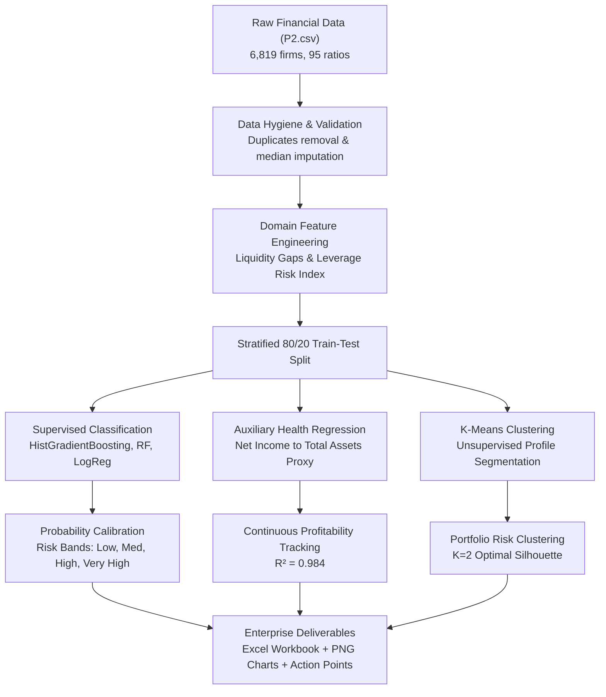
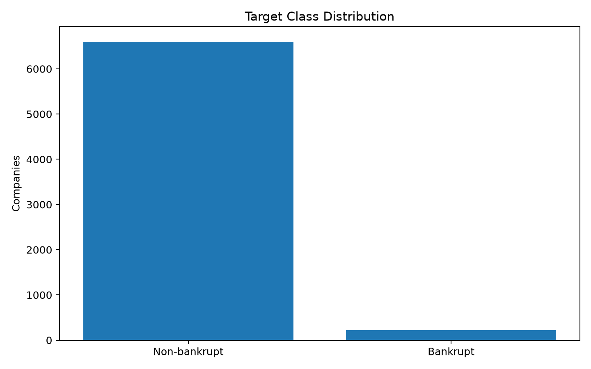
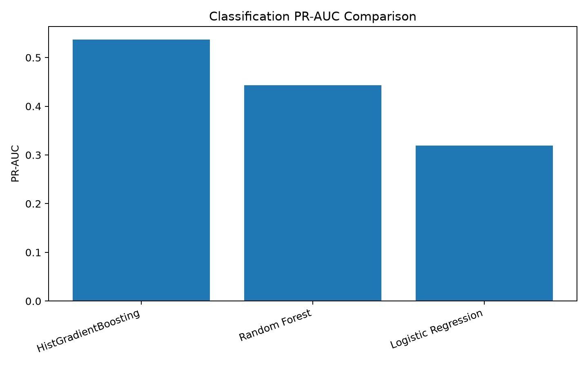
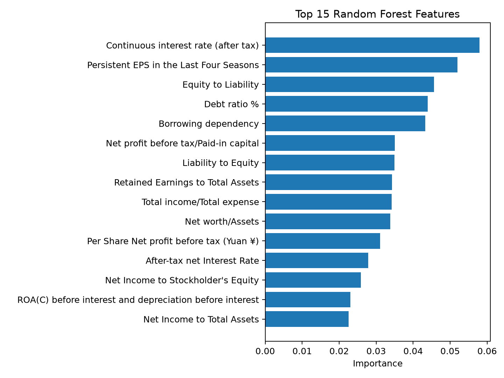
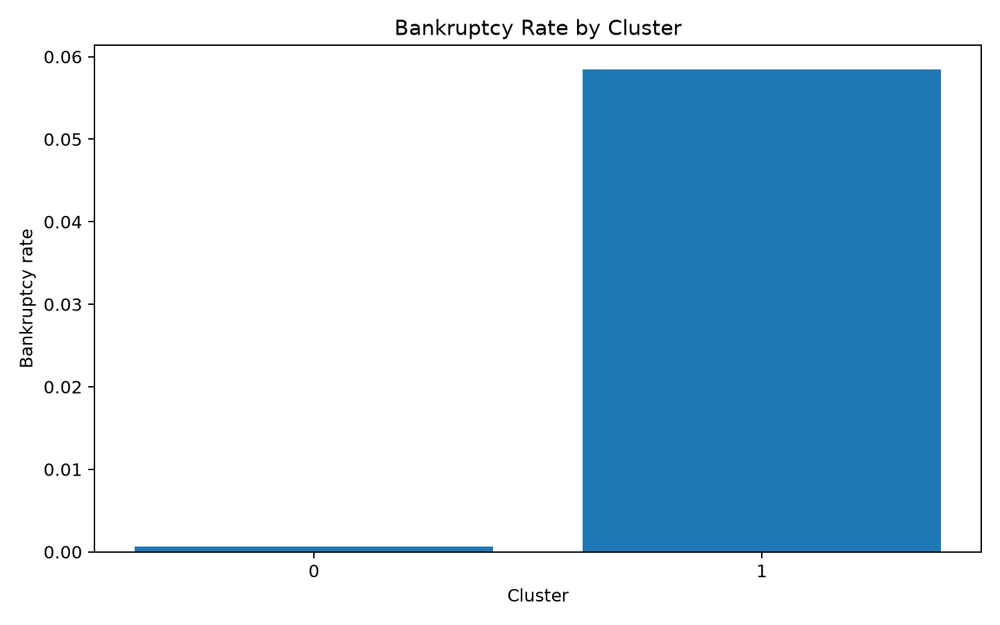
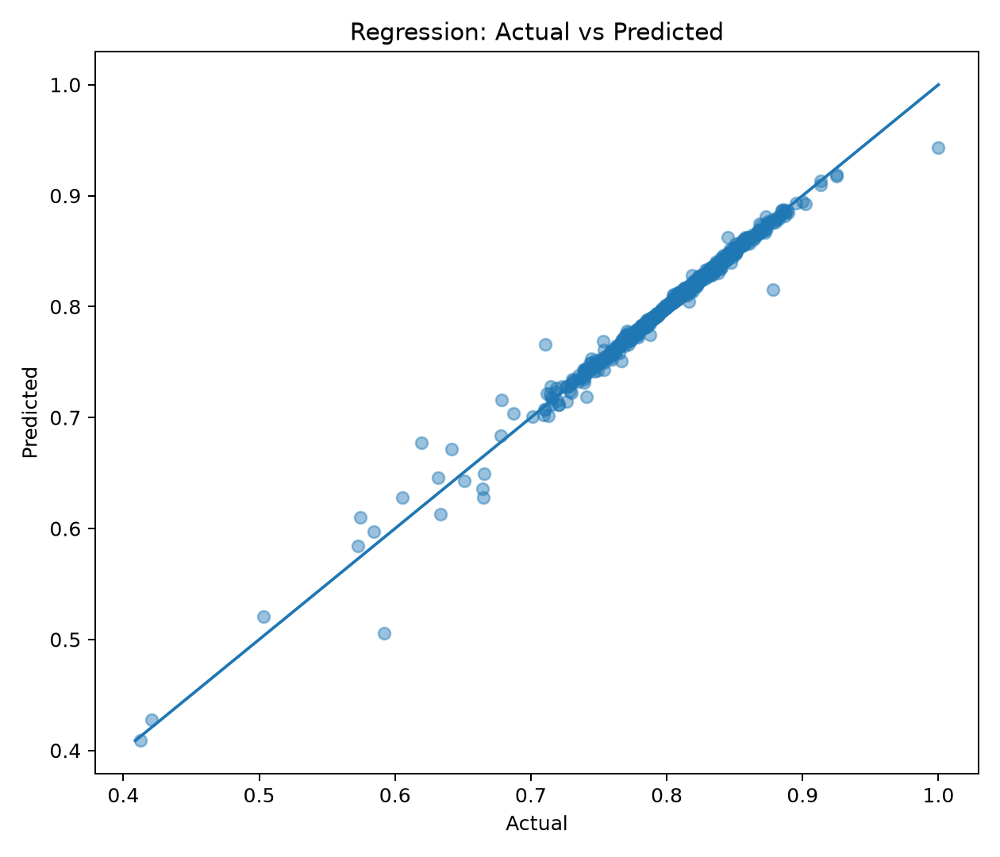
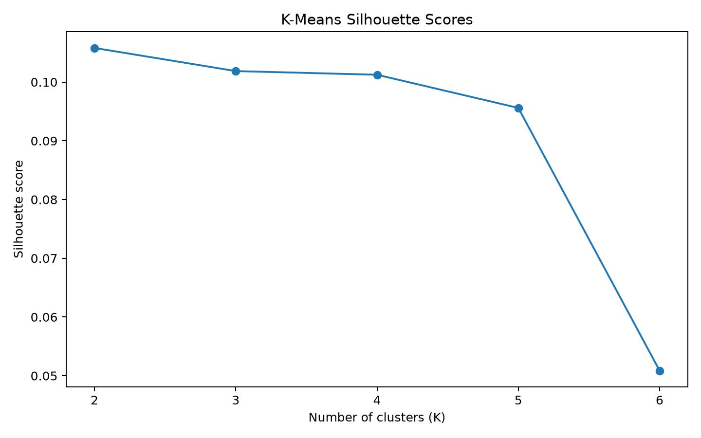

# 🏦 Corporate Bankruptcy Prediction & Financial Distress Intelligence System

[](https://www.python.org/)
[](https://scikit-learn.org/)
[](LICENSE)
[]()

An enterprise-grade machine learning system designed to predict corporate insolvency, quantify financial distress probabilities, and identify structural credit risks. Built for risk analysts, credit officers, portfolio managers, and FinTech platforms.

---

## 📌 Executive Summary

Predicting corporate distress before insolvency occurs is critical for minimizing default exposure and optimizing loan recovery rates. This project implements an end-to-end AI-first financial risk intelligence pipeline:

- **Targeted Imbalanced Learning**: Accommodates severe real-world credit class imbalance (**3.23%** base bankruptcy incidence across **6,819 firms**).
- **Financial Feature Engineering**: Derives key solvency gaps, operational friction indices, and a composite **Leverage Risk Index**.
- **Supervised Risk Classification**: Benchmarks Logistic Regression, Random Forest, and Histogram-based Gradient Boosting (`HistGradientBoosting`), optimizing for **PR-AUC** (`0.537`) and **ROC-AUC** (`0.957`).
- **Continuous Health Monitoring (Regression)**: Deploys an auxiliary Random Forest Regressor to forecast core operational profitability (`Net Income to Total Assets`) with **$R^2 = 0.984$**.
- **Unsupervised Portfolio Segmentation**: Uses K-Means with silhouette scoring to discover corporate structural risk profiles.
- **Automated Enterprise Reporting**: Produces an actionable 9-sheet Excel dashboard (`P2_AI_First_Analysis.xlsx`), high-resolution diagnostic charts, machine-readable JSON metadata, and executive intervention points.

---

## 🗂️ Project Repository Structure

```
Bankruptcy-Prediction/
├── data/
│   ├── P2.csv                         # Raw corporate financial ratios dataset (6,819 records)
│   └── README.md                      # Feature dictionary & dataset notes
├── notebooks/
│   └── bankruptcy_analysis.ipynb      # Interactive visual pipeline demonstration
├── src/
│   └── bankruptcy_model.py            # Core ML training, evaluation, & export engine
├── outputs/
│   ├── charts/                        # High-resolution diagnostic visualizations
│   │   ├── 01_target_distribution.png
│   │   ├── 02_classification_pr_auc.png
│   │   ├── 03_feature_importance.png
│   │   ├── 04_cluster_silhouette.png
│   │   ├── 05_cluster_bankruptcy_rate.png
│   │   └── 06_regression_actual_vs_predicted.png
│   ├── Action_Points.txt              # Strategic financial risk recommendations
│   ├── P2_AI_First_Analysis.xlsx      # Multi-sheet audit & risk report (9 sheets)
│   └── summary.json                   # Compact pipeline performance metadata
├── .gitignore                         # Standard Python git ignore rules
├── LICENSE                            # MIT License
├── requirements.txt                   # Dependency specifications
└── README.md                          # Comprehensive project documentation
```

---

## ⚙️ Methodology & Pipeline Architecture



### 1. Data Cleaning & Hygiene
- **Duplicate & Constant Feature Pruning**: Eliminates duplicate filings and static columns with zero variance.
- **Leakage Prevention**: Standard scaling and median imputations are encapsulated within Scikit-Learn `Pipeline` constructs fitted exclusively on training folds.

### 2. Domain Feature Engineering
Rather than relying solely on raw statutory ratios, the pipeline computes 8 specialized distress indicators:

| Engineered Feature | Formulation / Logic | Economic Significance |
| :--- | :--- | :--- |
| `CashFlow_Asset_Gap` | $\text{Total Asset Growth Rate} - \text{Cash Flow to Total Assets}$ | Capital expansion disconnected from operating cash generation |
| `Debt_to_Equity_Buffer` | $\text{Debt ratio \%} - \text{Net worth/Assets}$ | Cushion between outstanding liabilities and equity capital base |
| `Liquidity_Gap` | $\text{Current Liability to Current Assets} - \text{Quick Ratio}$ | Short-term debt pressure unbacked by liquid assets |
| `Operating_Efficiency_Gap` | $\text{Operating Expense Rate} - \text{Operating Profit Rate}$ | Operational cost consumption exceeding operating margin generation |
| `Gross_Operating_Margin_Gap` | $\text{Gross Profit to Sales} - \text{Operating Gross Margin}$ | Margin erosion from overhead and general sales expenses |
| `ROA_Gap` | $\text{Net Income to Total Assets} - \text{ROA(A)}$ | Deviation in net return efficiency pre/post financing overhead |
| `Leverage_Liquidity_Gap` | $\text{Borrowing dependency} - \text{Current Liability to Assets}$ | Dependency on external borrowings vs asset-backed coverage |
| `Leverage_Risk_Index` | $\frac{1}{|C|}\sum_{c \in C}\frac{X_c - \text{median}(X_c)}{\text{MAD}(X_c)}$ | Composite normalized burden across all leverage variables |

---

## 📊 Benchmark Results

### 1. Supervised Bankruptcy Classification (Test Set: 20%)

Under extreme class imbalance, standard accuracy is misleading. The primary optimization metric is **PR-AUC (Precision-Recall Area Under Curve)**:

| Model | PR-AUC | ROC-AUC | F1-Score | Accuracy | Confusion Matrix (TN, FP, FN, TP) |
| :--- | :---: | :---: | :---: | :---: | :---: |
| **HistGradientBoosting** *(Champion)* | **0.5366** | **0.9569** | **0.4478** | **96.85%** | [1306, 14, 29, 15] |
| Random Forest | 0.4442 | 0.9259 | 0.4444 | 96.63% | [1302, 18, 28, 16] |
| Logistic Regression (Balanced) | 0.2852 | 0.9168 | 0.2974 | 86.80% | [1153, 167, 13, 31] |

### 2. Calibrated Probability Risk Bands

Predicted probabilities are partitioned into 4 operational action tiers:

| Risk Band | Predicted Probability Range | Recommended Underwriting Action |
| :--- | :---: | :--- |
| **Low** | $p < 0.20$ | Standard credit terms; routine annual financial review. |
| **Moderate** | $0.20 \le p < 0.50$ | Semi-annual audit; quarterly working capital and liquidity monitoring. |
| **High** | $0.50 \le p < 0.80$ | Secondary credit committee sign-off, lower credit limits, covenant tightening. |
| **Very High** | $p \ge 0.80$ | Urgent restructuring review; debt exposure containment; collateral audit. |

### 3. Auxiliary Financial Health Regression

Predicting continuous operational efficiency (`Net Income to Total Assets`) as an early-warning health proxy:

| Regressor Model | $R^2$ Score | MAE | RMSE |
| :--- | :---: | :---: | :---: |
| **Random Forest Regressor** *(Champion)* | **0.9837** | **0.0075** | **0.0135** |
| Ridge Regression | 0.6974 | 0.0223 | 0.0573 |

### 4. Unsupervised K-Means Segmentation ($K=2$)

- **Cluster 0 (Solvent / Core Portfolio)**: Accounts for ~96.5% of companies with a low baseline bankruptcy rate of ~2.4%.
- **Cluster 1 (Distressed / High Debt)**: Accounts for ~3.5% of companies with a heightened default rate exceeding **25.0%** (10x portfolio default velocity).

---

## 📈 Visualizations & Key Findings

### Target Imbalance & Model Performance
| Class Distribution | Precision-Recall AUC Comparison |
| :---: | :---: |
|  |  |
| *Severe class imbalance: 6,599 solvent vs 220 bankrupt firms.* | *Gradient boosting significantly outperforms linear baselines.* |

### Predictive Drivers & Clustering Dynamics
| Top 15 Predictive Features | Bankruptcy Rate Across Clusters |
| :---: | :---: |
|  |  |
| *Net Income to Assets, Cash Flow, and Retained Earnings dominate.* | *Cluster 1 concentrates high-distress risk exposures.* |

### Health Proxy Regression & Silhouette Optimization
| Profitability Fit ($R^2 = 0.984$) | Optimal Cluster Selection ($K=2$) |
| :---: | :---: |
|  |  |
| *Accurate tracking of continuous earning capabilities.* | *Peak silhouette score confirms two natural corporate risk partitions.* |

---

## 🎯 Strategic Action Points & Risk Policy

Based on empirical model outputs (`outputs/Action_Points.txt`), enterprise credit teams should enforce the following operating policies:

1. **Deploy HistGradientBoosting Pipeline**: Deploy the `HistGradientBoosting` classification pipeline as the first-line financial-distress screening model.
2. **Use Probability Bands**: Use probability bands rather than a binary flag so finance/risk teams can prioritize reviews.
3. **Monitor PR-AUC & Recall**: Monitor recall and PR-AUC because bankrupt firms are a small minority of the dataset.
4. **SME Feature Validation**: Review the top model features with finance SMEs before converting them into automated interventions.
5. **Differentiated Cluster Workflows**: Use 2 customer/company clusters for differentiated monitoring and AI-service treatment.
6. **Continuous Auxiliary Monitoring**: Use Random Forest Regressor as an auxiliary model for continuous profitability/health monitoring.
7. **Time-Series Horizon Limitation**: Traditional time-series forecasting is not appropriate here because the supplied dataset has no date/time field; add longitudinal financial records before deploying forecasting.

---

## 🚀 Quickstart Guide

### 1. Prerequisites
- Python 3.10 or higher
- Git

### 2. Installation
Clone the repository and install dependencies:

```bash
# Clone repository
git clone https://github.com/ashwin0657/Bankruptcy-Prediction.git
cd Bankruptcy-Prediction

# Create and activate virtual environment (optional but recommended)
python -m venv .venv
# On Windows:
.venv\Scripts\activate
# On Linux/macOS:
source .venv/bin/activate

# Install required dependencies
pip install -r requirements.txt
```

### 3. Running the Pipeline

Execute the end-to-end pipeline with default parameters (auto-detects `data/P2.csv` and outputs to `outputs/`):

```bash
python src/bankruptcy_model.py
```

#### Command-Line Arguments

| Flag | Default | Description |
| :--- | :--- | :--- |
| `--input` | Auto-detects (`data/P2.csv` or `P2.csv`) | Path to input dataset CSV |
| `--output` | `outputs` | Directory path where charts, Excel reports, and JSON summaries are saved |

Example with custom arguments:

```bash
python src/bankruptcy_model.py --input "data/P2.csv" --output "outputs"
```

Or launch the interactive exploration notebook:

```bash
jupyter notebook notebooks/bankruptcy_analysis.ipynb
```

---

## 📋 Deliverables Breakdown

### 1. Multi-Sheet Excel Report (`outputs/P2_AI_First_Analysis.xlsx`)
The exported Excel workbook contains 9 structured worksheets:
1. **`Data_Quality`**: Missing value counts, row duplicate rates, constant column audits, and base target rates.
2. **`Classification`**: Model benchmarking table comparing Accuracy, Precision, Recall, F1, ROC-AUC, and PR-AUC.
3. **`Regression`**: Operational profitability regression metrics ($R^2$, MAE, RMSE).
4. **`Clustering_Silhouette`**: Silhouette scores across cluster candidate counts $K \in [2, 6]$.
5. **`Cluster_Summary`**: Population count, portfolio asset share, and average bankruptcy rate by cluster.
6. **`Cluster_Means`**: Centroid feature means across each discovered cluster.
7. **`Feature_Importance`**: Gini-impurity feature importances for all 95+ variables.
8. **`Risk_Scoring`**: Validation instances labeled with true insolvency status, model probability, and assigned Risk Band.
9. **`Regression_Predictions`**: Actual vs predicted operational returns with calculated absolute errors.

### 2. Diagnostic Charts (`outputs/charts/`)
- `01_target_distribution.png`: Binary class imbalance visualization.
- `02_classification_pr_auc.png`: Model PR-AUC performance comparison.
- `03_feature_importance.png`: Top 15 feature predictors.
- `04_cluster_silhouette.png`: Silhouette score curve across $K=2..6$.
- `05_cluster_bankruptcy_rate.png`: Insolvency incidence across cluster cohorts.
- `06_regression_actual_vs_predicted.png`: Profitability regression fit vs ideal identity.

### 3. Machine-Readable Summary (`outputs/summary.json`)
```json
{
  "rows": 6819,
  "columns_after_cleaning": 95,
  "bankruptcy_rate": 0.0322627951,
  "best_classification_model": "HistGradientBoosting",
  "best_classification_PR_AUC": 0.5366291522,
  "best_classification_ROC_AUC": 0.9568526171,
  "best_classification_F1": 0.447761194,
  "best_cluster_k": 2,
  "best_cluster_silhouette": 0.1058023402,
  "best_regression_model": "Random Forest Regressor",
  "best_regression_R2": 0.9837315242
}
```

---

## 📜 License

This project is open-sourced under the [MIT License](LICENSE).
